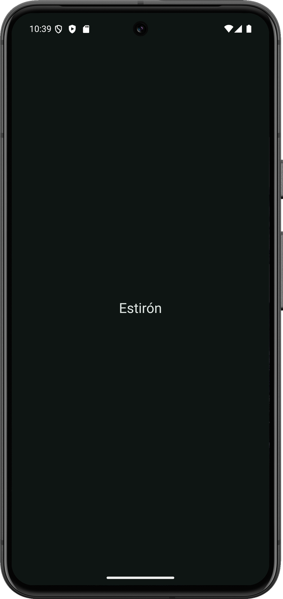

# Estirón - Del prototipo al código (I)

Tarea 2 de Desarrollo de Interfaces (2º DAM, MEDAC). Autor: Sergio Mitchell Bocero.

En esta tarea he pasado la pantalla Inicio de Estirón, la app de ropa infantil de la [tarea 1](https://github.com/sergiomitbo/diu-t1-ropainfantil), de Figma a un proyecto de Android Studio. He analizado la pantalla, he preparado una copia del archivo de Figma para desarrollo y he creado el proyecto con los recursos que necesita: colores, textos, fuente, estilos, tema, iconos y fotos. La pantalla completa se hace en la segunda parte; de momento la app solo muestra el título.

## Enlaces

- Figma (solo lectura): https://www.figma.com/design/uTCd5jzA8MpjtxgiepBOn5?node-id=1-2038
- Memoria: [docs/mitchell_sergio_figma_android.pdf](docs/mitchell_sergio_figma_android.pdf)

## Dónde está cada actividad

- A1, árbol de bloques: [docs/A1_analisis_inicio.md](docs/A1_analisis_inicio.md)
- A2, capas renombradas y frame listo para desarrollo: en el archivo de Figma
- A3, ficha de especificaciones: [docs/A3_ficha_inicio.md](docs/A3_ficha_inicio.md)
- A4, proyecto Android (Java, Empty Views Activity, API 28 y ViewBinding): carpeta app
- A5, recursos: res/values, res/values-night y res/font
- A6, inventario de assets: [docs/A6_inventario_assets.md](docs/A6_inventario_assets.md)
- A7, reflexión: en la memoria

## Cómo ejecutarlo

Abrir el proyecto en Android Studio, esperar a que sincronice Gradle y ejecutar app en un emulador o un móvil con Android 9 (API 28) o superior.

## Créditos

- Fuente Roboto, con licencia Apache 2.0 ([licencia](docs/licencias/Roboto_LICENSE.txt)).
- Fotos de producto de Unsplash.
